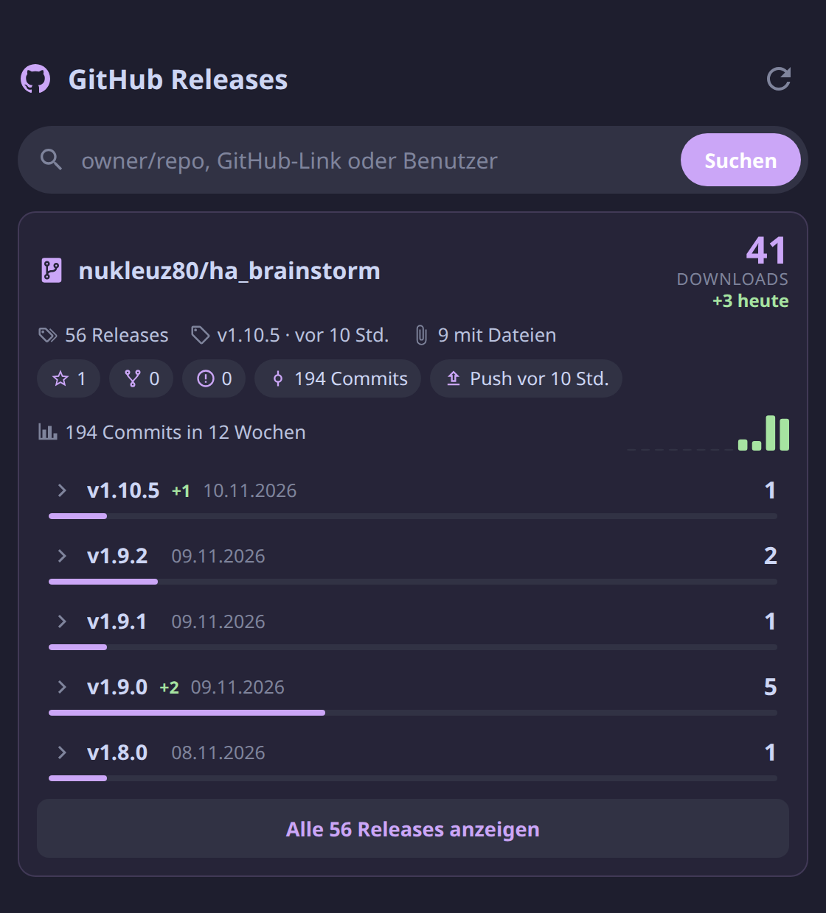

# GitHub Stats Card

[](https://github.com/nukleuz80/ha_github-release-stats-card/releases)
[](https://github.com/nukleuz80/ha_github-release-stats-card/actions/workflows/validate.yml)

🇩🇪 [Deutsche Version](README_de.md)

A Lovelace card for Home Assistant with the statistics of your GitHub repositories: release downloads today and in total, stars, commits, and optionally views, clones and wiki edits. Pin your own repositories to the card and look up any other one with the search bar.



> The card's interface is in German.

## Features

- **Downloads** per repository and per release, with a bar per release. Tap a release to see its title, mini description excerpt (changelog notes), and files with size and download count.
- **Downloads today** (`+3 heute`) per repository and per release. See [How "today" is counted](#how-today-is-counted).
- **Search** on top: `owner/repo`, a GitHub link, or a user name for a list of their repositories.
- **Repository details**: stars, forks, open issues, total commits and the last push.
- **Activity**: commits of the last 12 weeks as a bar chart (or smooth spline chart in Modern mode).
- **Views & clones** (optional): views, unique visitors, clones, referrers (Google, forum, Reddit …) and popular pages, with a daily chart. Needs a GitHub token that stays in Home Assistant, see [Setting up views & clones](#setting-up-views--clones).
- **Wiki** (optional): recently changed wiki pages, edits of the last 30 days and, with the traffic sensor, the most read wiki pages.
- **No token in the browser, no backend**: it reads the public GitHub API straight from the browser. Answers are cached and revalidated with ETags, so reloading the dashboard costs no API quota (60 requests per hour without a token).
- Uses the theme colors of Home Assistant and [Catppuccin](https://github.com/catppuccin/home-assistant) when present, so it works in light and dark themes. Works on phones.
- Visual editor in the dashboard.

## Installation

1. Download [`github-release-stats-card.js`](https://raw.githubusercontent.com/nukleuz80/ha_github-release-stats-card/main/github-release-stats-card.js) and copy it to `/config/www/`.
2. Under **Settings → Dashboards → ⋮ → Resources**, add `/local/github-release-stats-card.js?v=1.4.2` as a **JavaScript module**. If your resources are managed in YAML, add it to `lovelace.yaml` and restart Home Assistant.
3. Reload the browser. When you update the file, raise `?v=` so browsers load the new version.

## Configuration

Add the card with **Add card → GitHub Stats**, or in YAML:

```yaml
type: custom:github-release-stats-card
title: GitHub Stats
layout: modern # or "classic" for the legacy layout
repositories:
  - nukleuz80/ha_brainstorm
  - https://github.com/hacs/integration
```

| Option | Default | Description |
| :--- | :--- | :--- |
| `title` | `GitHub Stats` | Card title |
| `layout` | `classic` | Layout style: `classic` (compact layout) or `modern` (Venus-inspired KPI grid & spline chart) |
| `repositories` | `[]` | Repositories that always stay on the card, as `owner/repo` or a GitHub link |
| `releases` | `5` | Releases shown per repository, the rest behind "Alle … anzeigen" |
| `refresh` | `60` | Minutes between updates (at least 5) |
| `show_search` | `true` | Search bar on top |
| `show_details` | `true` | Stars, forks, issues, commits and last push |
| `show_activity` | `true` | Commits of the last 12 weeks |
| `show_traffic` | `true` | Views & clones, once a matching sensor exists |
| `traffic_days` | `30` | Days in the traffic chart (7 to 90) |
| `show_wiki` | `false` | Wiki section: recently changed pages (one request per update) |
| `hide_empty` | `false` | Hide releases without files |

## Setting up views & clones

GitHub only hands out views, clones, referrers and popular pages with a token, and only for repositories the token can push to. To keep the token out of the dashboard config and the browser, Home Assistant fetches the numbers itself and the card only reads a sensor.

1. **Create a token:** GitHub → Settings → Developer settings → [Fine-grained tokens](https://github.com/settings/personal-access-tokens/new). Under *Repository access* pick only the repositories you want, under *Permissions* set **Administration: Read-only**. Nothing else is needed.
2. **`secrets.yaml`:** `github_stats_token: "Bearer github_pat_…"` (with `Bearer ` in front).
3. Add the three pieces from [`examples/traffic`](examples/traffic):
   - [`rest_command.yaml`](examples/traffic/rest_command.yaml): GitHub request with the token
   - [`script.yaml`](examples/traffic/script.yaml): script `github_traffic_fetch`, fetches the four values of a repository
   - [`template.yaml`](examples/traffic/template.yaml): trigger-based template sensor per repository, updated hourly
4. Check the configuration and reload "REST commands" and "Template entities" under **Developer tools → YAML**.

The card finds the sensor by its attributes `github_traffic: true` and `repository`. GitHub keeps traffic for 14 days only, so the sensor collects the daily numbers in its `history` attribute (90 days) and the chart can show longer periods. To update right away, fire the event `github_traffic_refresh`.

Wiki pages show up under "Beliebte Seiten" when they are among the 10 most visited pages of the repository. GitHub has no statistics per wiki page.

## How "today" is counted

GitHub only reports the total downloads of each file, not downloads per day. Each time the card loads, it notes the totals together with the time GitHub sent them. Per day it keeps the first and the last count, for 31 days, in the Home Assistant user data of the signed-in user. All your devices share it, and other users have their own.

**Today** is the current total minus the last count of yesterday. This needs the dashboard to have been open somewhere shortly before midnight:

- `+N heute`: the last count of yesterday was taken at most 2 hours before midnight.
- `+N heute*`: the last count is older, the tooltip says since when.
- `+N seit 14:05`: the first day, counted since the first load.

Only pinned repositories are counted, a search only shows the totals.

## What GitHub counts as a download

Only files attached to a release (assets) are counted. The source code archives that GitHub adds to every release are not. HACS downloads those archives for integrations unless the repository sets `zip_release` in its `hacs.json` and attaches a ZIP to every release. Without that, HACS installs do not show up here.

## Version history & changelog

| Version | Date | Highlights |
| :--- | :--- | :--- |
| 1.4.2 | 2026-11-12 | Readable names for popular pages (GitHub now sends only paths as titles); views and clones each on their own chart scale; chart covers only recorded days |
| 1.4.1 | 2026-11-12 | Renamed to GitHub Stats (card type, file and repository stay the same) |
| 1.4.0 | 2026-11-12 | Views & clones (views, clones, referrers, popular pages, daily chart) through a Home Assistant sensor with a token; wiki section with recently changed and most read pages |
| 1.3.1 | 2026-11-11 | Expanding a release now reveals its title, mini description excerpt (changelog notes), and file downloads list |
| 1.3.0 | 2026-11-11 | New optional modern Venus dashboard layout (`layout: modern`) with KPI metric cards, spline commit chart, pill badges, and capsule progress bars; fully backwards-compatible with `layout: classic` |
| 1.2.1 | 2026-11-11 | Own repository for manual installation. A count keeps the time GitHub sent it, so a cached answer no longer looks like new downloads |
| 1.2.0 | 2026-11-10 | Downloads today per repository and per release, history in the Home Assistant user data |
| 1.1.0 | 2026-11-10 | Stars, forks, issues, commits, last push, commit activity of 12 weeks |
| 1.0.0 | 2026-11-10 | First version: pinned repositories, search, downloads per release and file, ETag cache |

## Credits

Inspired by [GitHub Release Stats](https://somsubhra.github.io/github-release-stats/) by Somsubhra Bairi.

## License

[MIT](LICENSE)
