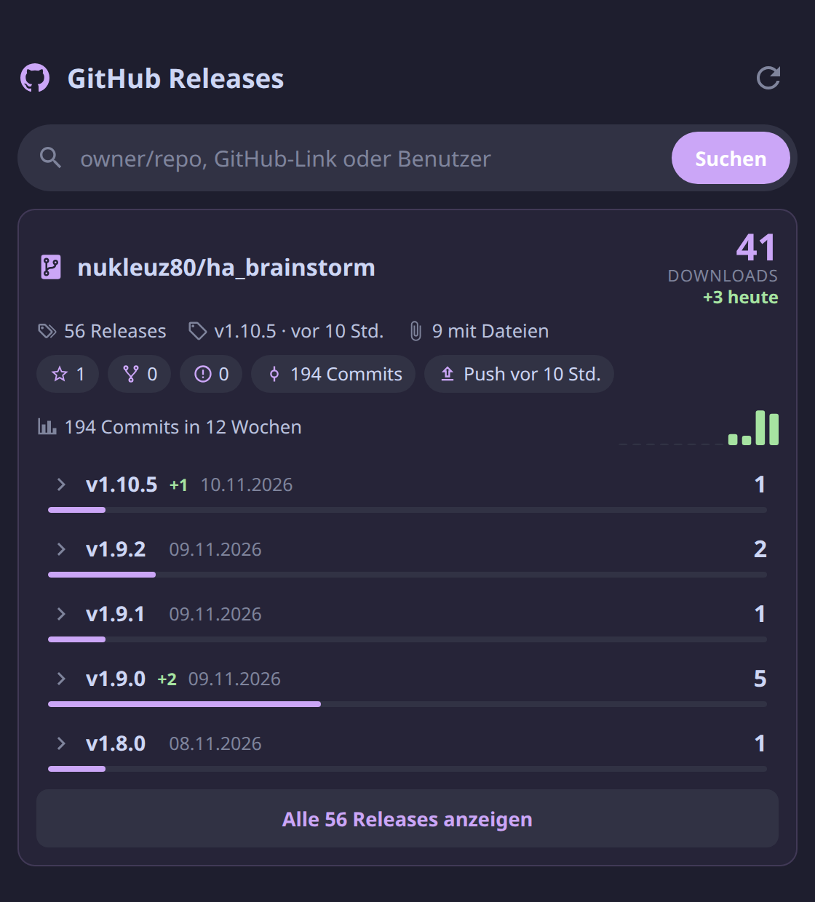

# GitHub Stats Card

[](https://github.com/nukleuz80/ha_github-release-stats-card/releases)
[](https://github.com/nukleuz80/ha_github-release-stats-card/actions/workflows/validate.yml)

🇬🇧 [English version](README.md)

Eine Lovelace-Karte für Home Assistant mit den Statistiken deiner GitHub-Repositories: Release-Downloads heute und insgesamt, Sterne, Commits und optional Aufrufe, Clones und Wiki-Änderungen. Eigene Repositories heftest du dauerhaft an, jedes andere findest du über die Suche.



## Funktionen

- **Downloads** pro Repository und pro Release, mit einem Balken pro Release. Ein Tipp auf ein Release zeigt seinen Titel, eine Mini-Beschreibung (Changelog-Auszug) und die Release-Dateien mit Größe und Downloads.
- **Downloads heute** (`+3 heute`) pro Repository und pro Release, siehe [So wird „heute“ gezählt](#so-wird-heute-gezählt).
- **Suche** oben: `owner/repo`, ein GitHub-Link oder ein Benutzername für eine Liste seiner Repositories.
- **Details**: Sterne, Forks, offene Issues, Commits insgesamt und der letzte Push.
- **Aktivität**: Commits der letzten 12 Wochen als Balkendiagramm (oder Spline-Chart im Modern-Design).
- **Besucher & Clones** (optional): Aufrufe, einzelne Besucher, Clones, Herkunft (Google, Forum, Reddit …) und beliebte Seiten, mit Tagesdiagramm. Braucht einen GitHub-Token, der in Home Assistant bleibt, siehe [Besucher & Clones einrichten](#besucher--clones-einrichten).
- **Wiki** (optional): zuletzt geänderte Wiki-Seiten, Änderungen der letzten 30 Tage und mit Traffic-Sensor die meistgelesenen Wiki-Seiten.
- **Kein Token im Browser, kein Server**: Die Karte liest das öffentliche GitHub-API direkt im Browser. Antworten werden zwischengespeichert und mit ETags geprüft, ein Neuladen des Dashboards kostet also kein Kontingent (60 Abfragen pro Stunde ohne Token).
- Nutzt die Farben des Home-Assistant-Themes und von [Catppuccin](https://github.com/catppuccin/home-assistant), wenn vorhanden. Funktioniert hell, dunkel und auf dem Handy.
- Grafischer Editor im Dashboard.

## Installation

1. [`github-release-stats-card.js`](https://raw.githubusercontent.com/nukleuz80/ha_github-release-stats-card/main/github-release-stats-card.js) herunterladen und nach `/config/www/` kopieren.
2. Unter **Einstellungen → Dashboards → ⋮ → Ressourcen** `/local/github-release-stats-card.js?v=1.4.2` als **JavaScript-Modul** hinzufügen. Werden die Ressourcen in YAML verwaltet, in `lovelace.yaml` eintragen und Home Assistant neu starten.
3. Den Browser neu laden. Nach einem Update `?v=` hochzählen, damit Browser die neue Version laden.

## Konfiguration

Über **Karte hinzufügen → GitHub Stats** oder in YAML:

```yaml
type: custom:github-release-stats-card
title: GitHub Stats
layout: modern # oder "classic" für das bisherige Layout
repositories:
  - nukleuz80/ha_brainstorm
  - https://github.com/hacs/integration
```

| Option | Standard | Beschreibung |
| :--- | :--- | :--- |
| `title` | `GitHub Stats` | Titel der Karte |
| `layout` | `classic` | Design-Layout: `classic` (bewährtes kompaktes Design) oder `modern` (Venus-Kacheldesign mit KPI-Tiles und Spline-Chart) |
| `repositories` | `[]` | Repositories, die immer auf der Karte stehen, als `owner/repo` oder GitHub-Link |
| `releases` | `5` | Angezeigte Releases pro Repository, der Rest hinter „Alle … anzeigen“ |
| `refresh` | `60` | Minuten zwischen zwei Aktualisierungen (mindestens 5) |
| `show_search` | `true` | Suchleiste oben |
| `show_details` | `true` | Sterne, Forks, Issues, Commits und letzter Push |
| `show_activity` | `true` | Commits der letzten 12 Wochen |
| `show_traffic` | `true` | Besucher & Clones, sobald ein passender Sensor existiert |
| `traffic_days` | `30` | Tage im Traffic-Diagramm (7 bis 90) |
| `show_wiki` | `false` | Wiki-Bereich: zuletzt geänderte Seiten (eine Abfrage pro Aktualisierung) |
| `hide_empty` | `false` | Releases ohne Dateien ausblenden |

## Besucher & Clones einrichten

GitHub gibt Aufrufe, Clones, Herkunft und beliebte Seiten nur mit einem Token heraus, und auch nur für Repositories, auf die der Token Schreibzugriff hat. Damit der Token nicht in der Dashboard-Konfiguration oder im Browser landet, holt Home Assistant die Zahlen selbst. Die Karte liest nur einen Sensor.

1. **Token anlegen:** GitHub → Settings → Developer settings → [Fine-grained tokens](https://github.com/settings/personal-access-tokens/new). Unter *Repository access* nur die gewünschten Repositories wählen, unter *Permissions* **Administration: Read-only**. Mehr braucht es nicht.
2. **`secrets.yaml`:** `github_stats_token: "Bearer github_pat_…"` (mit `Bearer ` davor).
3. Die drei Bausteine aus [`examples/traffic`](examples/traffic) übernehmen:
   - [`rest_command.yaml`](examples/traffic/rest_command.yaml): GitHub-Abfrage mit dem Token
   - [`script.yaml`](examples/traffic/script.yaml): Skript `github_traffic_fetch`, holt die vier Werte eines Repositories
   - [`template.yaml`](examples/traffic/template.yaml): Trigger-Template-Sensor pro Repository, stündlich aktualisiert
4. Konfiguration prüfen und unter **Entwicklerwerkzeuge → YAML** „REST-Befehle“ und „Template-Entitäten“ neu laden.

Die Karte findet den Sensor selbst über die Attribute `github_traffic: true` und `repository`. GitHub hebt Traffic nur 14 Tage auf. Der Sensor sammelt die Tageswerte deshalb im Attribut `history` (90 Tage), so zeigt das Diagramm auch längere Zeiträume. Sofort aktualisieren: Ereignis `github_traffic_refresh` auslösen.

Wiki-Seiten erscheinen unter „Beliebte Seiten“, wenn sie zu den 10 meistbesuchten Seiten des Repositories gehören. Eine eigene Statistik pro Wiki-Seite bietet GitHub nicht.

## So wird „heute“ gezählt

GitHub liefert nur die Gesamtzahl der Downloads pro Datei, keine Zahlen pro Tag. Bei jedem Laden merkt sich die Karte die Gesamtzahlen und den Zeitpunkt, an dem GitHub sie geliefert hat. Pro Tag behält sie die erste und die letzte Zählung, 31 Tage lang, in den Benutzerdaten des angemeldeten Home-Assistant-Benutzers. Alle deine Geräte teilen sie, andere Benutzer haben ihre eigenen.

**Heute** ist die aktuelle Gesamtzahl minus die letzte Zählung von gestern. Dafür muss das Dashboard kurz vor Mitternacht irgendwo offen gewesen sein:

- `+N heute`: Die letzte Zählung von gestern lag höchstens 2 Stunden vor Mitternacht.
- `+N heute*`: Die letzte Zählung ist älter, der Tooltip nennt den Zeitpunkt.
- `+N seit 14:05`: Am ersten Tag, gezählt ab dem ersten Laden.

Gezählt werden nur angeheftete Repositories, eine Suche zeigt nur die Gesamtzahlen.

## Was GitHub als Download zählt

Gezählt werden nur Dateien, die an einem Release hängen. Die Quellcode-Archive, die GitHub an jedes Release hängt, zählen nicht. Genau die lädt HACS bei Integrationen, außer das Repository setzt `zip_release` in seiner `hacs.json` und hängt an jedes Release eine ZIP-Datei. Sonst erscheinen HACS-Installationen hier nicht.

## Versionshistorie & Changelog

| Version | Datum | Highlights |
| :--- | :--- | :--- |
| 1.4.2 | 12.11.2026 | Lesbare Namen für beliebte Seiten (GitHub schickt als Titel nur noch Pfade), Aufrufe und Clones mit eigener Skala im Diagramm, Diagramm nur über aufgezeichnete Tage |
| 1.4.1 | 12.11.2026 | Neuer Name GitHub Stats (Kartentyp, Datei und Repository bleiben gleich) |
| 1.4.0 | 12.11.2026 | Besucher & Clones (Aufrufe, Clones, Herkunft, beliebte Seiten, Tagesdiagramm) über einen Home-Assistant-Sensor mit Token, Wiki-Bereich mit zuletzt geänderten und meistgelesenen Seiten |
| 1.3.1 | 11.11.2026 | Beim Aufklappen eines Releases werden nun Release-Name, eine Mini-Beschreibung (Changelog-Auszug) und die Dateiliste übersichtlich angezeigt |
| 1.3.0 | 11.11.2026 | Neues optionales Modern-Design im Venus-Dashboard-Stil (KPI-Kacheln, Spline-Commit-Chart, Pill-Badges, Capsule-Progressbars), umschaltbar über `layout: classic` oder `modern` |
| 1.2.1 | 11.11.2026 | Eigenes Repository zur manuellen Installation. Eine Zählung behält den Zeitpunkt der GitHub-Antwort, eine zwischengespeicherte Antwort sieht nicht mehr wie neue Downloads aus |
| 1.2.0 | 10.11.2026 | Downloads heute pro Repository und pro Release, Verlauf in den Home-Assistant-Benutzerdaten |
| 1.1.0 | 10.11.2026 | Sterne, Forks, Issues, Commits, letzter Push, Commit-Aktivität über 12 Wochen |
| 1.0.0 | 10.11.2026 | Erste Version: angeheftete Repositories, Suche, Downloads pro Release und Datei, ETag-Cache |

## Danke

Inspiriert von [GitHub Release Stats](https://somsubhra.github.io/github-release-stats/) von Somsubhra Bairi.

## Lizenz

[MIT](LICENSE)
